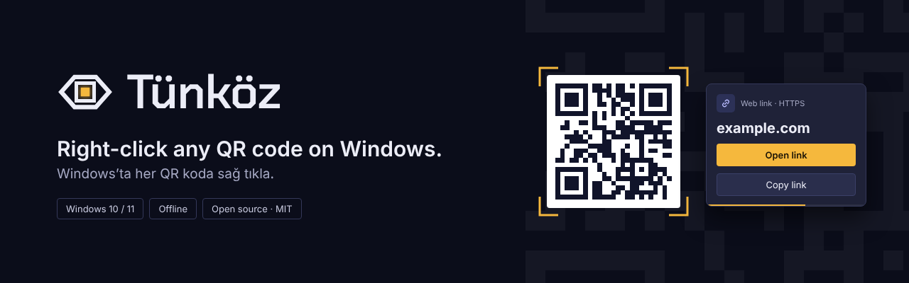
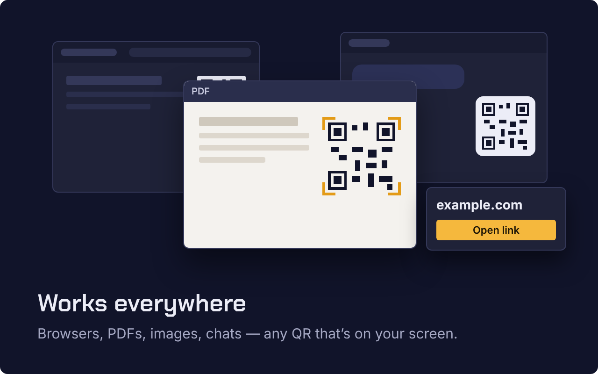
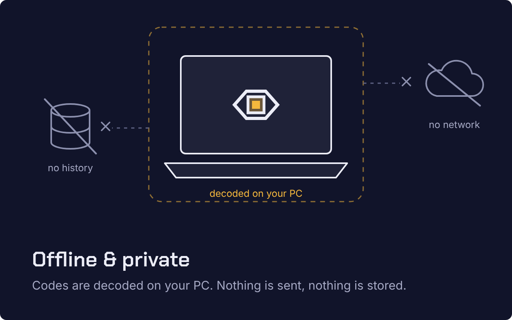
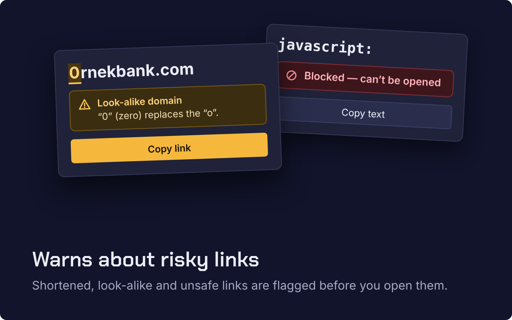

<p align="center">
  
</p>

<p align="center">
  <a href="https://github.com/lupusoftco/tunkoz/releases/latest"></a>
  
  <a href="LICENSE"></a>
</p>

# Tünköz

**Right-click any QR code on Windows.**
Windows’ta her QR koda sağ tıkla.

On macOS you can right-click a QR code and open its link. Windows has no such thing — the closest is Snipping Tool, four steps away. **Tünköz** brings that one-click experience to Windows, system-wide: right-click a QR code in any app — a browser, a PDF, a photo, a chat window, a paused video — and a small card appears next to the app’s own menu with the decoded content.

> **Tünköz** is Old Turkic *tün* (night) + *köz* (eye): the eye that sees in the dark.

## Download

1. Grab **`Tunkoz-…-win-x64.exe`** from the [latest release](https://github.com/lupusoftco/tunkoz/releases/latest).
2. Run it. There’s no installer and no admin rights needed; Tünköz lives in the notification area.
3. Right-click any QR code on screen.

> Builds aren’t code-signed yet, so Windows SmartScreen may warn on first run: choose **More info → Run anyway**.

## Features

<table>
  <tr>
    <td width="33%"></td>
    <td width="33%"></td>
    <td width="33%"></td>
  </tr>
</table>

- **Right-click, nothing else.** No hotkey, no region to drag. The app’s own context menu still opens normally — Tünköz only adds its card beside it.
- **Works everywhere.** Browsers, PDFs, images, chats: any QR that’s on your screen.
- **Warns about risky links.** The real domain is shown large and bold. Shortened, look-alike (punycode), raw-IP and plain-HTTP links get a warning before you open them. `javascript:`, `data:`, `file:` and `ms-*` links are never opened — you can only copy the text.
- **Understands the content.** Web links, Wi-Fi (copy password / network name), contacts (save as `.vcf`), phone, email, SMS, locations and plain text.
- **Offline & private.** Codes are decoded on your PC. Nothing is sent, nothing is stored.
- **Feels native.** Windows 11 look, follows your light/dark setting, Turkish and English.

## How it compares

| | Tünköz | Snipping Tool (Text actions) | Hotkey + region tools |
|---|---|---|---|
| Steps to open a QR link | Right-click → **Open link** | Win+Shift+S → select → open → Text actions | Hotkey → drag a box → open |
| Works in any app | ✓ | ✓ | ✓ |
| Shows the real domain & warns | ✓ | — | — |
| Never opens `javascript:` / `file:` | ✓ | — | — |
| Offline | ✓ | ✓ | varies |

## Privacy

- No network calls, no telemetry, no image or content logging. Screen captures exist only in memory, around the cursor, for the moment of the right-click.
- The mouse hook only observes the right-click position. Tünköz never reads keystrokes and never installs a keyboard hook.
- Settings (just the language for now) live in `%AppData%\Tunkoz\settings.json`.
- Clicks on apps running as administrator aren’t seen — that’s how Windows isolates them.

Details: [PRIVACY.md](PRIVACY.md).

## Build from source

Requires the [.NET 8 SDK](https://dotnet.microsoft.com/download/dotnet/8.0) on Windows.

```powershell
git clone https://github.com/lupusoftco/tunkoz
cd tunkoz
dotnet test
dotnet publish src/Tunkoz/Tunkoz.csproj -c Release -r win-x64 --self-contained -p:PublishSingleFile=true -o publish
```

Run `publish\Tunkoz.exe --debug` to also open the detection console (timings and decoded payloads).

### Project layout

- `src/Tunkoz.Core` — payload parsing, link-safety analysis and QR decoding (ZXing.Net), with unit tests in `tests/`.
- `src/Tunkoz` — the WPF tray app: low-level mouse hook, screen capture, result card, tray menu, settings.
- `design/` — tokens, logo and icons from the design system.

## Contributing

Issues and pull requests are welcome — see [CONTRIBUTING.md](CONTRIBUTING.md).

## License

[MIT](LICENSE) © Lupusoft. Chakra Petch font under the [SIL Open Font License](src/Tunkoz/Assets/Fonts/OFL.txt).

---

Built with ❤️ by [Lupusoft](https://lupusoft.com).
[GitHub](https://github.com/lupusoftco/tunkoz) · [Issues](https://github.com/lupusoftco/tunkoz/issues) · [Releases](https://github.com/lupusoftco/tunkoz/releases)
